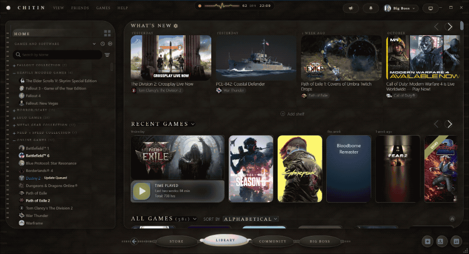
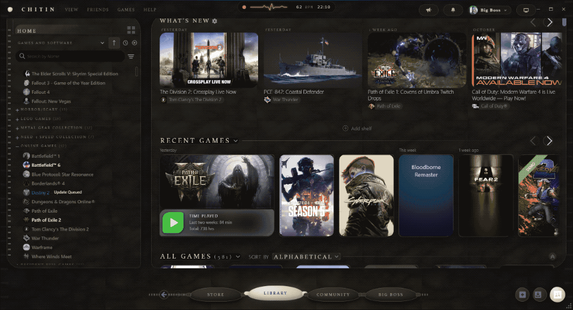

# Chitin

**A biomechanical interface, grown rather than built.** Bone white, charcoal, dull metal and a sickly ochre. A Steam client theme for [Beyond Steam](https://github.com/OriginalSwayze/Beyond-Steam) and [Millennium](https://steambrew.app).

- **A spine:** navigation is a horizontal spine along the bottom centre, with four **vertebrae** (Store / Library / Community / You) threaded on a cord. The active one turns bone-white and rises.
- **Grown panels:** asymmetric organic curves with a tissue texture. They breathe slowly, and a rib cage runs down the inner edge of the game list.
- **A heartbeat monitor** in the title bar shows an ECG trace, BPM and the time. The pulse quickens while a game is running.
- Round game icons, bone pills for selection, a pulsing PLAY capsule, and three **seed pods** for add, downloads and friends.
- A morphing gestation shape at boot.

## Install

- **With [Beyond Steam](https://github.com/OriginalSwayze/Beyond-Steam) (easiest):** in Steam press **Ctrl+Shift+B**, open
  **Get more** and install **Chitin**.
- **By hand:** download **Chitin.zip** from the [latest release](https://github.com/OriginalSwayze/Chitin/releases/latest) and unzip
  it into `%APPDATA%\Beyond Steam\themes\Chitin` (Beyond Steam) or `Steam\millennium\themes\Chitin` (Millennium).

## Options

In Beyond Steam's **Theme options** tab (or **Millennium → Themes → Chitin**) you can change:

Tissue (Bone, Ivory & rust, Bronze, Ash) · Breathing · Density · What's New · Readout · Startup screen · Motion · Cover hover · Privacy · Contrast · Focus rings · Text size

Everything here is original: no other game's names, logos, art or fonts. Fonts are ones that ship with Windows.

## License

MIT, see [LICENSE](LICENSE).
